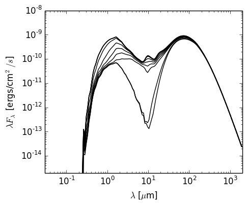

Typical Analytical YSO Model
============================

The following example model sets up the Class I model from `Whitney et al
(2003) <http://adsabs.harvard.edu/abs/2003ApJ...598.1079W>`_ For now, this
model does not include the accretion luminosity, but this will be added in the
future. First, we set up the model using the
:class:`~hyperion.model.AnalyticalYSOModel` class:

.. literalinclude:: scripts/class1_example_setup.py
   :language: python

.. note:: This example uses the ``kmh94_3.1_hg`` dust model provided by the
          `hyperion-dust <https://github.com/hyperion-rt/hyperion-dust>`_
          package, which can be installed with ``pip install hyperion-dust``.
          You will also need the stellar photosphere model from
          :download:`here <scripts/kt04000g+3.5z-2.0.ascii>`.

The model takes a few minutes to run on 12 processes (a little less than an hour in serial mode). We can then proceed for example to plotting the SED:

.. literalinclude:: scripts/class1_example_plot.py
   :language: python

which gives:

which is almost identical to the bottom left panel of Figure 3a of `Whitney et
al (2003) <http://adsabs.harvard.edu/abs/2003ApJ...598.1079W>`_ (the
differences being due to slightly different dust properties).
