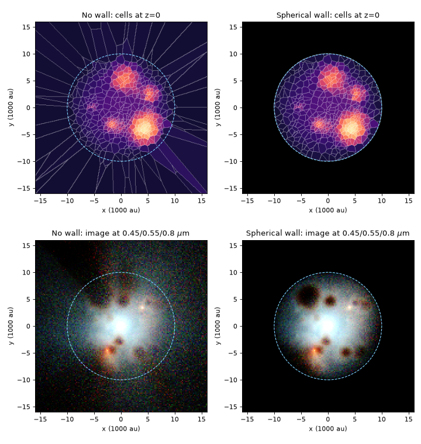

Setting up a model on a Voronoi grid
====================================

A Voronoi grid is defined by a set of points, which we call *sites*: each
site defines one cell, which contains all the positions that are closer to
that site than to any other site (see :ref:`voronoi_grid` for more details).
Voronoi grids are a natural choice if your density comes from a simulation
that uses particles (for example smoothed particle hydrodynamics) or a moving
mesh, since you can use the particle positions directly as the sites, and they
are also a convenient way to set up a model with high resolution only where it
is needed.

In this tutorial, we set up a clumpy spherical cloud on a Voronoi grid, lit by
three stars, and compute scattered light images at three wavelengths. We also
compare two ways of bounding the grid: a rectangular domain only, and a
rectangular domain combined with a spherical wall.

.. note:: This example uses the ``kmh94_3.1_hg`` dust model provided by the
          `hyperion-dust <https://github.com/hyperion-rt/hyperion-dust>`_
          package, which can be installed with ``pip install hyperion-dust``.

Setting up the model
--------------------

The full script is available :download:`here <scripts/voronoi_cloud_setup.py>`,
and we go through it step by step below.

Density
^^^^^^^

We first define the density of the cloud: a sphere with a radius of
10,000 au containing a smooth background, with a density decreasing
outwards, and 45 Gaussian clumps with random positions, sizes, and peak
densities:

.. literalinclude:: scripts/voronoi_cloud_setup.py
   :language: python
   :end-before: def random_points_in_sphere

Choosing the sites
^^^^^^^^^^^^^^^^^^

Next, we choose the positions of the sites. If you have particles from a
simulation, you can simply use the particle positions here. In this example,
we instead place the sites so that they follow the density: 3,000 sites
distributed uniformly across the cloud, and many more inside the clumps, so
that the cells are smallest where the density is highest:

.. literalinclude:: scripts/voronoi_cloud_setup.py
   :language: python
   :start-at: def random_points_in_sphere
   :end-before: # The density in each cell

This gives 13,905 sites. Since we will bound the grid with a sphere of radius
``R`` below, we make sure that all the sites are inside that sphere.

Density in each cell
^^^^^^^^^^^^^^^^^^^^

Hyperion needs one density value per cell, in the same order as the sites.
Here we simply use the value of the density at the position of each site:

.. literalinclude:: scripts/voronoi_cloud_setup.py
   :language: python
   :start-at: # The density in each cell
   :end-before: def setup_model

This is a good approximation only if the cells are small compared to the
scale over which the density changes, which is why we placed more sites
in the clumps. If your sites come from a simulation, you will typically use
the density of each particle instead.

Setting up the grid
^^^^^^^^^^^^^^^^^^^

We then define a function that sets up the model, since we will create the
same model twice: once without and once with a spherical wall. The grid is
set with :meth:`~hyperion.model.Model.set_voronoi_grid`, which takes the
positions of the sites and the limits of the rectangular domain (in cm),
within which the cells are computed:

.. literalinclude:: scripts/voronoi_cloud_setup.py
   :language: python
   :start-at: def setup_model
   :end-before: # Add the density, with one value per site

If you do not give the limits of the domain, the domain is the box enclosing
all the sites, with a border of 1 percent on each side. In both cases, the
cells of the outermost sites extend all the way to the edge of the rectangular
domain. Since our sites fill a sphere, the outermost cells then extend into
the corners of the domain, beyond the edge of the cloud, and the density we
assign to these cells fills a much larger volume than intended.

To avoid this, we can pass ``wall='sphere'`` and
``wall_args=(x0, y0, z0, r)``, where ``(x0, y0, z0)`` is the center of the
sphere and ``r`` is its radius (in cm). The cells are then also cut by the
sphere, and photons leave the grid when they cross it. All the sites must be
strictly inside the sphere. Note that each outer cell is cut by the plane
tangent to the sphere at the point closest to its site, so the boundary of
the grid is a polyhedral approximation of the sphere, which becomes better as
the number of cells near the boundary increases.

Dust, sources, and images
^^^^^^^^^^^^^^^^^^^^^^^^^

The rest of the setup is the same as for any other kind of grid. The density
is given as a 1-d array with one value per site, and we add three point
sources, as well as images at three wavelengths covering the whole domain:

.. literalinclude:: scripts/voronoi_cloud_setup.py
   :language: python
   :start-at: # Add the density, with one value per site
   :end-before: # We only compute scattered light images

Since we are only interested in scattered light at optical wavelengths, we
do not compute the temperature of the dust, and we use
:ref:`monochromatic-rt` to compute images only at the three wavelengths we
need (see also :doc:`howto_pure_scattering`):

.. literalinclude:: scripts/voronoi_cloud_setup.py
   :language: python
   :start-at: # We only compute scattered light images
   :end-before: for name, wall in

Running the models
^^^^^^^^^^^^^^^^^^

Finally, we write out and run the model without and with the spherical wall:

.. literalinclude:: scripts/voronoi_cloud_setup.py
   :language: python
   :start-at: for name, wall in

The two models take about a minute and a half each to run on a single core
(under three minutes in total for the whole script). To run them in parallel
with MPI instead, you can use for example::

    m.run(name + '.rtout', overwrite=True, mpi=True, n_processes=4)

Note that the random numbers then differ, so the noise in the images will
not be exactly the same as in the figure below.

.. warning:: In this example we only compute scattered light, but if you
             compute dust temperatures, then as for any other grid the cells
             need to be small enough to resolve the temperature gradients.
             The temperature varies most rapidly close to the sources and
             across optically thick boundaries (for example at the surface of
             a dense clump or disk), and these are not necessarily the places
             where the density is highest. A Voronoi grid taken directly from
             the particles of a simulation, or with sites placed according to
             the density as in this example, may therefore not have enough
             resolution there, for example in low-density regions around
             sources. In such cases, you may need to add sites in those
             regions (and assign a density to the new cells) to get accurate
             temperatures. As always, you can check whether the resolution is
             sufficient by increasing it and making sure that the results do
             not change.

Plotting the results
--------------------

To show the effect of the spherical wall, we make a figure with a slice
through the grid at z=0 for each model, and the corresponding images. We
read the sites and the density in each cell back from the output files with
:meth:`~hyperion.model.ModelOutput.get_quantities`, and find which cell each
pixel of the slice belongs to by finding the closest site. For the model with
the wall, we also blank out the pixels that are cut off by the wall:

.. literalinclude:: scripts/voronoi_cloud_plot.py
   :language: python

which gives:

The dashed circle shows the edge of the cloud. Without a wall (left), the
outer cells extend far beyond the cloud, to the edges of the domain, so the
model actually contains a large volume of material outside the sphere. This
material shows up as diffuse scattered light filling the whole image, with
straight-edged structures following the shapes of the large outer cells, and
the extra dust in front of the cloud reduces the contrast of the clumps. With
the spherical wall (right), the cells stop at the sphere, and the image shows
the cloud as intended.
