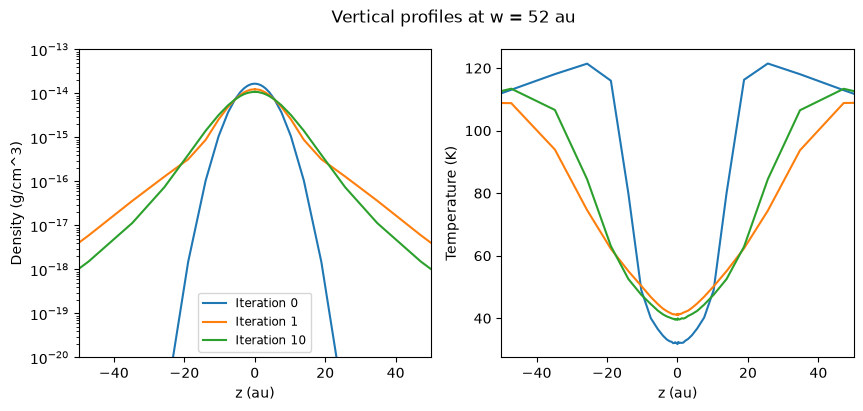

How to compute disk models in vertical hydrostatic equilibrium
==============================================================

When setting up a disk with :class:`~hyperion.model.AnalyticalYSOModel`, the
vertical structure of the disk is given by an analytical prescription (a
flared disk with a scale height that depends on radius). In a disk in vertical
hydrostatic equilibrium, the vertical density structure instead depends on the
temperature in the disk, which in turn depends on the density structure.
Hyperion includes a helper function,
:func:`~hyperion.model.helpers.run_with_vertical_hseq`, which finds a
self-consistent solution by alternating between computing the temperature with
the radiative transfer and recomputing the vertical density structure.

.. note:: :func:`~hyperion.model.helpers.run_with_vertical_hseq` is still
          experimental, so you should check the results carefully.

Setting up and running the model
--------------------------------

The model has to meet the following requirements:

* It should be an :class:`~hyperion.model.AnalyticalYSOModel` instance
* It should use a cylindrical polar grid set up with
  :meth:`~hyperion.model.AnalyticalYSOModel.set_cylindrical_polar_grid_auto`
* The stellar mass should be set
* It should include at least one disk

The following example sets up a flared disk around a low-mass star, and then
runs it with :func:`~hyperion.model.helpers.run_with_vertical_hseq` instead of
calling ``write`` and ``run`` directly:

.. literalinclude:: scripts/hseq_setup.py
   :language: python

.. note:: If you want to run this model you will need to download
          the :download:`kmh_lite.hdf5 <scripts/kmh_lite.hdf5>` dust file into the
          same directory as the script above (**disclaimer**: do not use this
          dust file outside of these tutorials!).

The first argument of :func:`~hyperion.model.helpers.run_with_vertical_hseq`
is a prefix for the files written out. The model is first written out and run
with the initial (analytical) density structure, as ``hseq_00000.rtin`` and
``hseq_00000.rtout``. Then, for each of the ``n_iter`` iterations, the
temperatures from the previous output file are used to compute a new density
structure, and the resulting model is written out and run as
``hseq_00001.rtin`` and ``hseq_00001.rtout``, ``hseq_00002.rtin`` and
``hseq_00002.rtout``, and so on. The last output file contains the final
model. As for :meth:`~hyperion.model.Model.run`, you can use ``mpi=True`` and
``n_processes=`` to run each model in parallel, and ``logfile=True`` writes
the output of each run to a log file (``hseq_00000.log``, etc.) instead of to
the terminal.

When recomputing the density structure, the following assumptions are made:

* The surface density of the disks (i.e. the mass in each vertical column of
  cells) is preserved, and only the vertical distribution is changed.
* The hydrostatic equilibrium is computed in the gravitational potential of
  the star only, so self-gravity of the disk is ignored (this may be
  important for massive disks).
* The gas is assumed to be a mix of molecular hydrogen and helium, with a mean
  molecular weight of 2.279. Whether the densities and dust opacities are
  specified for dust or gas+dust does not matter for this calculation.
* Only the density of the disks is modified. Other components such as
  envelopes and ambient media are left unchanged.
* Cells with no temperature (for example cells that no photons reached) are
  assigned the maximum temperature in the same vertical column.

Checking convergence
--------------------

The number of iterations is fixed by ``n_iter``, and no check is made of
whether the density structure has converged, so you should check this
yourself. The following script reads in the output files for all the
iterations, plots the vertical density and temperature profiles at a radius
of 50au for the initial model, the first iteration, and the last iteration,
and prints out the fraction of the disk mass that has moved between successive
iterations:

.. literalinclude:: scripts/hseq_plot.py
   :language: python

which gives:

and prints out::

    Fraction of mass moved in iteration 1: 0.279
    Fraction of mass moved in iteration 2: 0.147
    Fraction of mass moved in iteration 3: 0.023
    Fraction of mass moved in iteration 4: 0.005
    Fraction of mass moved in iteration 5: 0.005
    Fraction of mass moved in iteration 6: 0.005
    Fraction of mass moved in iteration 7: 0.004
    Fraction of mass moved in iteration 8: 0.005
    Fraction of mass moved in iteration 9: 0.004
    Fraction of mass moved in iteration 10: 0.005

In this case, the density structure has converged after about four
iterations: the remaining changes of around 0.5% are due to the Monte-Carlo
noise in the temperatures, and can be reduced by using more photons. If the
density structure has not converged, you can run more iterations.

This model takes about 25 minutes to run in serial mode.
