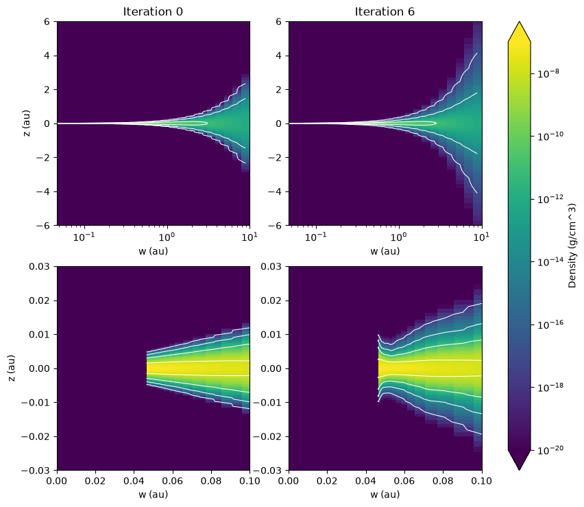

How to compute disk models in vertical hydrostatic equilibrium
==============================================================

When setting up a disk with :class:`~hyperion.model.AnalyticalYSOModel`, the
vertical structure of the disk is given by an analytical prescription (a
flared disk with a scale height that depends on radius). In a disk in vertical
hydrostatic equilibrium, the vertical density structure instead depends on the
temperature in the disk, which in turn depends on the density structure.
Hyperion includes a helper function,
:func:`~hyperion.model.helpers.run_with_vertical_hseq`, which finds a
self-consistent solution by alternating between computing the temperature with
the radiative transfer and recomputing the vertical density structure.

.. note:: :func:`~hyperion.model.helpers.run_with_vertical_hseq` is still
          experimental, so you should check the results carefully.

Setting up and running the model
--------------------------------

The model has to meet the following requirements:

* It should be an :class:`~hyperion.model.AnalyticalYSOModel` instance
* It should use a cylindrical polar grid set up with
  :meth:`~hyperion.model.AnalyticalYSOModel.set_cylindrical_polar_grid_auto`
* The stellar mass should be set
* It should include at least one disk

The following example sets up a flared disk around a low-mass star, and then
runs it with :func:`~hyperion.model.helpers.run_with_vertical_hseq` instead of
calling ``write`` and ``run`` directly:

.. literalinclude:: scripts/hseq_setup.py
   :language: python

.. note:: This example uses the ``kmh94_3.1_hg`` dust model provided by the
          `hyperion-dust <https://github.com/hyperion-rt/hyperion-dust>`_
          package, which can be installed with ``pip install hyperion-dust``.

Since the density structure is recomputed separately in each vertical column
of cells, the grid should have enough cells in the vertical direction to
resolve the vertical density profiles. This is set by the second argument of
:meth:`~hyperion.model.AnalyticalYSOModel.set_cylindrical_polar_grid_auto`,
which is set to 300 here.

The first argument of :func:`~hyperion.model.helpers.run_with_vertical_hseq`
is a prefix for the files written out. The model is first written out and run
with the initial (analytical) density structure, as ``hseq_00000.rtin`` and
``hseq_00000.rtout``. Then, for each of the ``n_iter`` iterations, the
temperatures from the previous output file are used to compute a new density
structure, and the resulting model is written out and run as
``hseq_00001.rtin`` and ``hseq_00001.rtout``, ``hseq_00002.rtin`` and
``hseq_00002.rtout``, and so on. The last output file contains the final
model. As for :meth:`~hyperion.model.Model.run`, you can use ``mpi=True`` and
``n_processes=`` to run each model in parallel, as is done above with four
processes (this requires Hyperion to have been compiled with MPI; otherwise,
remove these two arguments to run in serial mode), and ``logfile=True``
writes the output of each run to a log file (``hseq_00000.log``, etc.)
instead of to the terminal.

When recomputing the density structure, the following assumptions are made:

* The surface density of the disks (i.e. the mass in each vertical column of
  cells) is preserved, and only the vertical distribution is changed.
* The hydrostatic equilibrium is computed in the gravitational potential of
  the star only, so self-gravity of the disk is ignored (this may be
  important for massive disks).
* The gas is assumed to be a mix of molecular hydrogen and helium, with a mean
  molecular weight of 2.279. Whether the densities and dust opacities are
  specified for dust or gas+dust does not matter for this calculation.
* Only the density of the disks is modified. Other components such as
  envelopes and ambient media are left unchanged.
* Cells with no temperature (for example cells that no photons reached) are
  assigned the maximum temperature in the same vertical column.

Checking convergence
--------------------

The number of iterations is fixed by ``n_iter``, and no check is made of
whether the density structure has converged, so you should check this
yourself. The following script reads in the output files for all the
iterations, plots the vertical density and temperature profiles at a radius
of 5au for the initial model, the first iteration, and the last iteration,
and prints out the fraction of the disk mass that has moved between successive
iterations:

.. literalinclude:: scripts/hseq_plot.py
   :language: python

which gives:

.. image:: scripts/hseq_profiles.png
   :width: 100%
   :align: center

and prints out::

    Fraction of mass moved in iteration 1: 0.088
    Fraction of mass moved in iteration 2: 0.118
    Fraction of mass moved in iteration 3: 0.034
    Fraction of mass moved in iteration 4: 0.018
    Fraction of mass moved in iteration 5: 0.018
    Fraction of mass moved in iteration 6: 0.017

In this case, the density structure has converged after about four
iterations: the remaining changes of around 2% are due to the Monte-Carlo
noise in the temperatures, and can be reduced by using more photons. If the
density structure has not converged, you can run more iterations.

This model takes about 9 minutes to run with four MPI processes.

Visualizing the density structure
---------------------------------

To see how the structure of the disk as a whole has changed, the following
script plots the density in the (w, z) plane for the initial model and for
the last iteration, using the same color scale, both for the whole disk and
zoomed in on its inner edge:

.. literalinclude:: scripts/hseq_maps.py
   :language: python

which gives:

The white lines show contours of constant density (at 10\ :sup:`-17`,
10\ :sup:`-14`, 10\ :sup:`-11`, and 10\ :sup:`-8` g/cm\ :sup:`3`). The upper
layers of the disk are heated directly by the star and are much warmer than
the midplane, so in hydrostatic equilibrium the disk is more extended
vertically than the initial model, especially in the outer parts of the disk.
Since the mass in each vertical column is preserved, the density in the
midplane is correspondingly lower.

The zoom on the inner edge of the disk (bottom row) shows that in hydrostatic
equilibrium the disk becomes thicker right at its inner edge than just behind
it: the inner edge of the disk is illuminated directly by the star and is
therefore hotter, and it shadows the disk behind it. This is the puffed-up
inner rim that is expected for disks around young stars.
